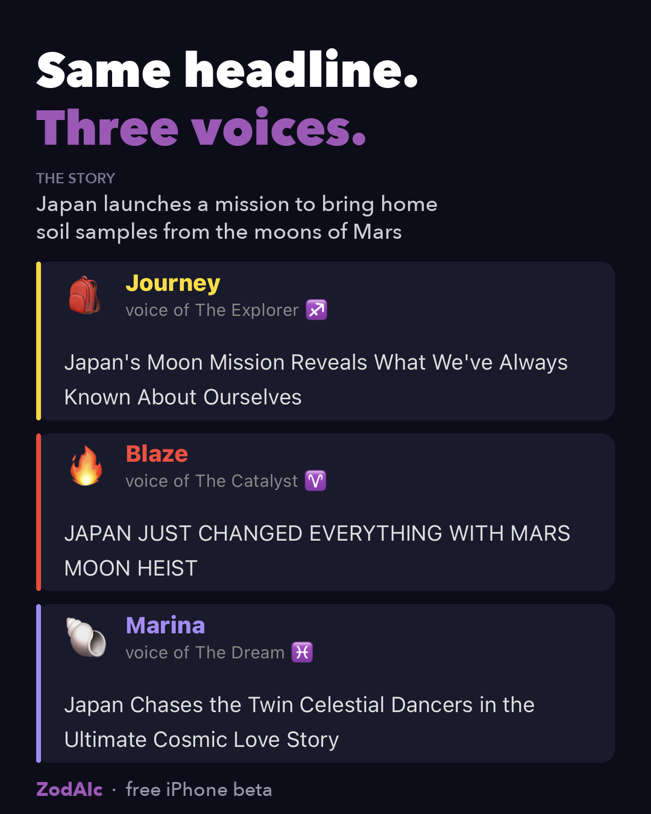

# ZodAIc

**Read the news through twelve AI voices.**

We all read the same headlines. We don't all read them the same way. ZodAIc sorts the
day's stories into 12 "digital signs," a playful take on the zodiac, and each sign has
its own AI voice with its own personality, obsessions, and blind spots. Pick a story
and see how a dreamer, an analyst, or a hype machine would read it, or ask any voice to
weigh in on a topic you choose.

The zodiac is just the starting point. The goal is a tool for understanding perspectives:
how other people might see the same thing. Other frameworks, such as Myers-Briggs, are
planned.

<p align="center">
  
</p>

## Join the beta

ZodAIc is in a free beta on iPhone. **[Join on TestFlight](https://testflight.apple.com/join/NPck2h3Y)**
(you'll need Apple's free TestFlight app; the link walks you through it).

Feedback is welcome: take a screenshot in the app and tap **Share Beta Feedback**, or
[open an issue](https://github.com/miken12r/zodaic/issues).

## Under the hood

Built solo as a hands-on exploration of applied AI, with production-minded safeguards.

- **AI pipeline.** Hourly news ingestion; Claude classifies each story into a sign, and
  each sign's voice writes its take, with the model matched to the task (Haiku for
  high-volume takes, Sonnet for classification). "Ask a voice" uses Claude's web search
  tool to find fresh stories on any topic.
- **AI guardrails.** The model decides the tone first, so stories about real harm get a
  respectful take instead of a lampoon. Facts must match the article, and only the voice's
  reaction is exaggerated. "Ask a voice" screens requests and declines inappropriate ones,
  with per-user and global daily limits.
- **Security and privacy.** Row-level security on every table. The app only reads, and
  server-side functions do all writes with keys kept off the device. Other users'
  profiles are served through a view that exposes only public fields, so birth dates are
  never visible to anyone else.
- **Cost-conscious.** Free tiers wherever possible (Supabase, GNews, Expo) plus
  pay-as-you-go Claude usage.
- **Stack.** TypeScript throughout: Expo / React Native, Supabase (Postgres, RLS, Deno
  Edge Functions, pg_cron), the Anthropic Claude API, and EAS Build + TestFlight.

---

## Project Structure

```
zodaic/
├── app/                             # Expo React Native app (iOS first)
│   ├── app/                         # Expo Router screens
│   │   ├── index.tsx                # Redirects to sign-in
│   │   ├── article.tsx              # Article reader (WebView + reader mode + "Ask another voice")
│   │   ├── setup.tsx                # First-run profile setup (username, display name, birth date)
│   │   ├── (auth)/sign-in.tsx       # Auth screen
│   │   └── (tabs)/                  # Main tab screens
│   │       ├── home.tsx             # News: feed ranked by sign compatibility
│   │       ├── takes.tsx            # Takes: persona-voiced headline/blurb feed
│   │       ├── sites.tsx            # Sites: "Ask a voice" about a topic, or classify a pasted link
│   │       ├── feed.tsx             # Webstrology: AI-generated compatibility reading
│   │       ├── discover.tsx         # Networking: find people, shared stories
│   │       └── profile.tsx          # Birth date → sign, follow counts, feed settings
│   ├── assets/                      # icon.png, splash.png, adaptive-icon.png — placeholders, swap for real branding
│   └── src/
│       ├── components/              # ShareCard, SignDetailModal, UserProfileSheet, VoicePicker, FeedSettings
│       ├── constants/
│       │   ├── signs.ts             # The 12 ZodAIc signs (identity: name/color/symbol)
│       │   └── personas.ts          # Character-sheet data (voice/displayName/avatar) each sign's Hot Takes draw on
│       ├── lib/
│       │   ├── supabase.ts          # Supabase client
│       │   ├── api.ts               # API calls
│       │   ├── profileFields.ts     # Shared profile validation and date helpers
│       │   ├── profileStatus.ts     # Profile-completion signal for the setup redirect
│       │   └── signTakes.ts         # Hot Takes data layer — kept separate from api.ts, see Key Decisions
│       └── types/index.ts           # TypeScript types
└── supabase/
    ├── migrations/                  # Database schema (run in order — see Setup)
    └── functions/
        ├── _shared/                 # personas.ts (Deno mirror of the client's), generateSignTake.ts + signTakePrompt.ts (shared take generation)
        ├── ask-persona/             # "Ask a voice": finds recent stories on a topic via Claude web search (rate-limited)
        ├── classify-content/        # Claude-powered URL → sign classifier
        ├── generate-horoscope/      # Claude-powered weekly/monthly horoscope generator
        ├── generate-portails/       # Compatibility reading across all 12 signs
        ├── generate-lens/           # "Read through [sign] eyes" article summary
        ├── extract-article/         # Readability-based extraction for reader mode
        ├── delete-account/          # Deletes the signed-in user's account
        ├── fetch-news/              # Hourly news ingestion (GNews free tier + Claude haiku), pg_cron-scheduled
        ├── generate-sign-take/      # On-demand Hot Takes generation (cache-or-generate-then-persist)
        └── generate-sign-takes-batch/ # Batch Hot Takes generation, pg_cron-scheduled every 20 min
```

---

## Setup

### 1. Install Node.js

```bash
# Install via nvm (recommended)
curl -o- https://raw.githubusercontent.com/nvm-sh/nvm/v0.39.0/install.sh | bash
source ~/.zshrc
nvm install --lts
```

### 2. Install Expo CLI & dependencies

```bash
cd ~/Projects/zodaic/app
npm install
npm install -g expo-cli
```

### 3. Set up Supabase

1. Go to [supabase.com](https://supabase.com) and create a new project
2. In the SQL editor, run every file in `supabase/migrations/` **in filename order**.
   - Before `20260908_sign_takes_cron.sql`, store the service role key in Vault
     (`select vault.create_secret('<your-service-role-key>', 'service_role_key');`)
     and replace `<PROJECT_REF>` in the file with this project's actual ref; see the
     comment at the top of the file.
   - Older migrations create tables without explicit grants. Supabase stops
     auto-granting Data API access to new tables as of 2026-10-30, so a fresh project
     needs `grant select` (to `authenticated`) and `grant all` (to `service_role`) on
     those tables; see `CLAUDE.md`.
3. Copy your project URL and anon key from Settings → API

### 4. Set up environment variables

```bash
cd ~/Projects/zodaic/app
cp .env.example .env
# Edit .env with your Supabase URL and anon key
```

**This `.env` file only covers local development** (`npx expo start --dev-client` reads it
directly off disk via Metro). A cloud build (`eas build --profile production` or
`preview`) runs on Expo's servers, which have no access to your local filesystem —
without a separate step, the compiled app silently ships with no Supabase URL/key at all
and crashes on launch. Register the same values with EAS once, and they'll be baked into
every future cloud build automatically:

```bash
npx eas env:set --name EXPO_PUBLIC_SUPABASE_URL --value "<your-supabase-url>" \
  --environment production preview development --visibility plaintext --scope project

npx eas env:set --name EXPO_PUBLIC_SUPABASE_ANON_KEY --value "<your-anon-key>" \
  --environment production preview development --visibility plaintext --scope project
```

`--visibility plaintext` is correct here specifically because these are `EXPO_PUBLIC_*`
variables — they're inlined into the client JS bundle regardless (anyone can extract them
from the compiled app), and the anon key is Supabase's own "publishable" key type. Don't
use `plaintext` for anything that isn't meant to be public.

### 5. Deploy Supabase Edge Functions

```bash
# Install Supabase CLI
npm install -g supabase

# Link to your project
supabase login
supabase link --project-ref YOUR_PROJECT_REF

# Set API keys as secrets (GNews: free plan, non-commercial use)
supabase secrets set ANTHROPIC_API_KEY=your_anthropic_api_key
supabase secrets set GNEWS_API_KEY=your_gnews_api_key

# Deploy functions
supabase functions deploy classify-content
supabase functions deploy generate-horoscope
supabase functions deploy generate-portails
supabase functions deploy generate-lens
supabase functions deploy extract-article
supabase functions deploy fetch-news
supabase functions deploy generate-sign-take
supabase functions deploy generate-sign-takes-batch
supabase functions deploy ask-persona
supabase functions deploy delete-account
```

`fetch-news` is scheduled hourly via `pg_cron`, confirmed live on the project
(`0 * * * *`) — this schedule is **not** tracked in any migration, only configured
directly on the hosted project, so it won't be reproduced by re-running this repo's
migrations alone. `generate-sign-takes-batch` runs every 20 minutes via the
`20260908_sign_takes_cron.sql` migration (properly tracked, unlike `fetch-news`'s);
its cadence and cap were sized against `fetch-news`'s observed output of 7-22
articles/hour — see the comment above `BATCH_GENERATION_LIMIT` in
`generate-sign-takes-batch/index.ts` if that volume changes significantly.

To generate a batch of Hot Takes on demand (rather than waiting for the cron), invoke
`generate-sign-takes-batch` directly:
```bash
curl -X POST "https://<PROJECT_REF>.supabase.co/functions/v1/generate-sign-takes-batch" \
  -H "Authorization: Bearer <SERVICE_ROLE_KEY>" -H "Content-Type: application/json" -d '{}'
```

### 6. Build and run the development client

This project uses a custom [EAS development client](https://docs.expo.dev/development/introduction/) instead of Expo Go. Expo Go only ever supports the latest SDK version, so relying on it means the app can stop launching on your device the moment Expo ships a new SDK — a dev client we control lets us upgrade on our own schedule instead.

**One-time setup** (per developer, per device — requires an Apple Developer Program membership, or access under the `ai-for-society` org's):

```bash
cd ~/Projects/zodaic/app
npx eas login                                        # your Expo/EAS account — ask to be added to the ai-for-society org
npx eas device:create                                # registers your device for provisioning
npx eas build --profile development --platform ios   # builds the dev client in the cloud
```

Open the build page EAS gives you on your iOS device and tap Install.

**Day-to-day:**

```bash
cd ~/Projects/zodaic/app
npx expo start --dev-client
```

Scan the printed QR code with your device's camera — it opens in the installed dev client instead of Expo Go.

---

## The 12 ZodAIc Signs

| Sign | Digital Analog | Traditional | Voice |
|------|---------------|-------------|-------|
| ⚡ The Catalyst | Breaking news, startups, viral trends | Aries | 🔥 Blaze |
| 📚 The Archive | Encyclopedias, reference, documentation | Taurus | 🦉 Gerald |
| 💬 The Stream | Social media, messaging, commentary | Gemini | 📱 Riley |
| 🌙 The Sanctuary | Wellness, community, mental health | Cancer | 🧘 Sage |
| ⭐ The Spotlight | Entertainment, celebrity, streaming | Leo | 📸 Star |
| 🔬 The Analyst | Data, research, analytics, technical | Virgo | 🤓 Bob |
| ⚖️ The Forum | Debate, reviews, op-eds, marketplaces | Libra | 🤝 Frank |
| 🔦 The Depths | Investigative journalism, security research | Scorpio | 🕵️ Doug |
| 🧭 The Explorer | Education, travel, philosophy, courses | Sagittarius | 🎒 Journey |
| 💼 The Enterprise | Business, finance, B2B, productivity | Capricorn | 📈 Chad |
| 🕸️ The Network | Open source, tech, decentralized | Aquarius | 🌱 Pip |
| 🌌 The Dream | Art, music, film, spirituality | Pisces | 🐚 Marina |

---

## Key Decisions

- **Expo over bare React Native** — faster iteration, easy iOS deployment, cross-platform path to Android
- **Supabase over custom backend** — auth, database, real-time, and edge functions in one; no server to manage
- **Claude API for classification** — LLM semantic understanding handles the nuanced task of mapping content to signs far better than rules-based approaches
- **Edge Functions over a separate API** — API keys stay server-side, latency is low, no extra infrastructure
- **Custom EAS dev client over Expo Go** — Expo Go only supports the latest SDK, so it broke device testing outright the first time Expo shipped a new one. A dev client we control costs an Apple Developer Program membership and some build setup, but decouples us from Apple's/Expo's release schedule
- **Hot Takes built as its own module, not folded into Home** — the Takes tab may become the new home screen after UI iteration, so its table, edge functions, and client data layer (`signTakes.ts`, deliberately not added to `api.ts`) are kept separate from `home.tsx`'s code so it can be lifted out or promoted later without untangling
- **Shared generation core for Hot Takes** — both the on-demand and batch edge functions call one `_shared/generateSignTake.ts` rather than each duplicating the Claude call, specifically to avoid repeating this codebase's existing pattern of drifting duplicate sign-trait copies across `classify-content`/`fetch-news`/`generate-lens`. Persona data itself still has two sources of truth (client `constants/personas.ts`, edge `_shared/personas.ts`) since edge functions can't import the client's path-aliased file — kept in sync by hand, not automated
